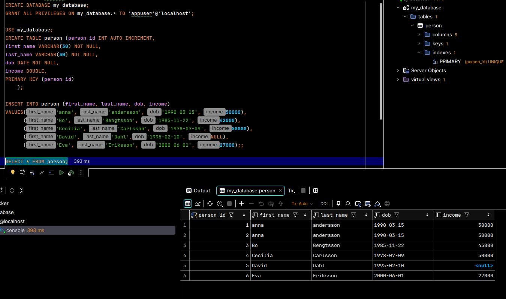
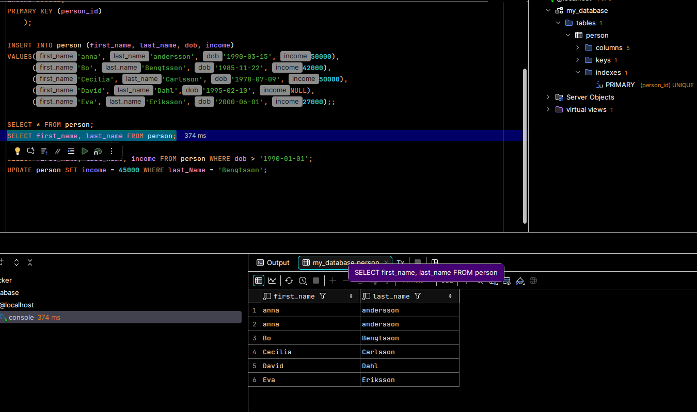
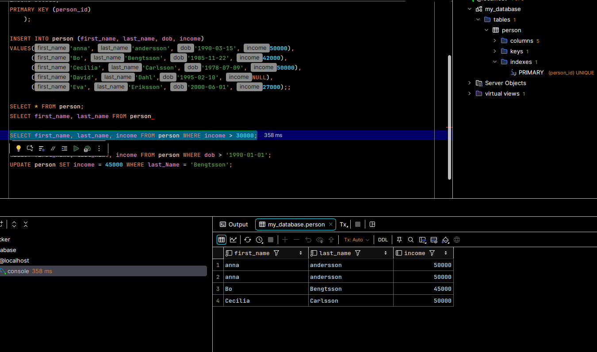
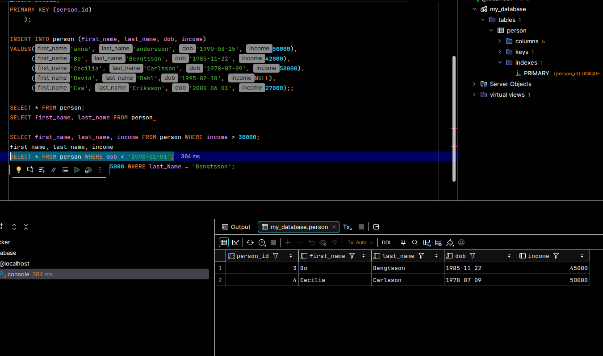
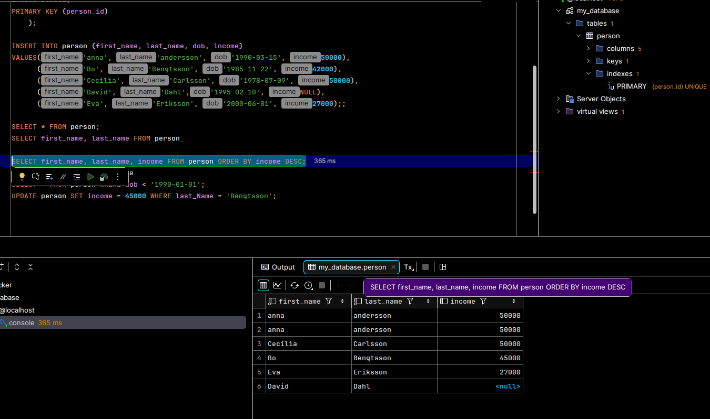
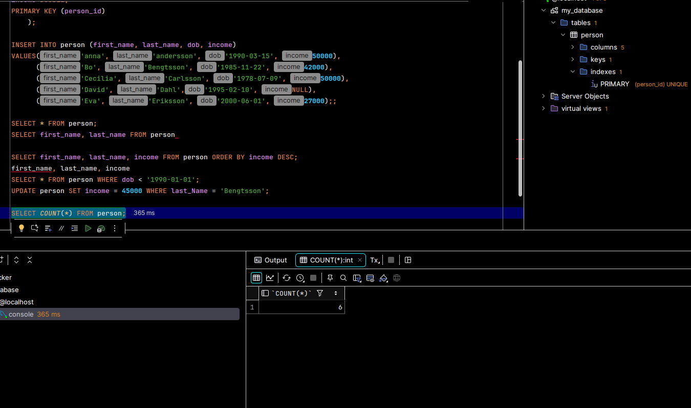
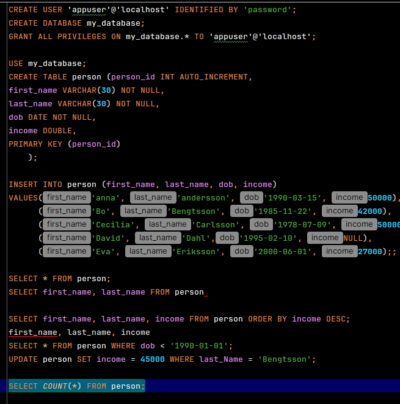
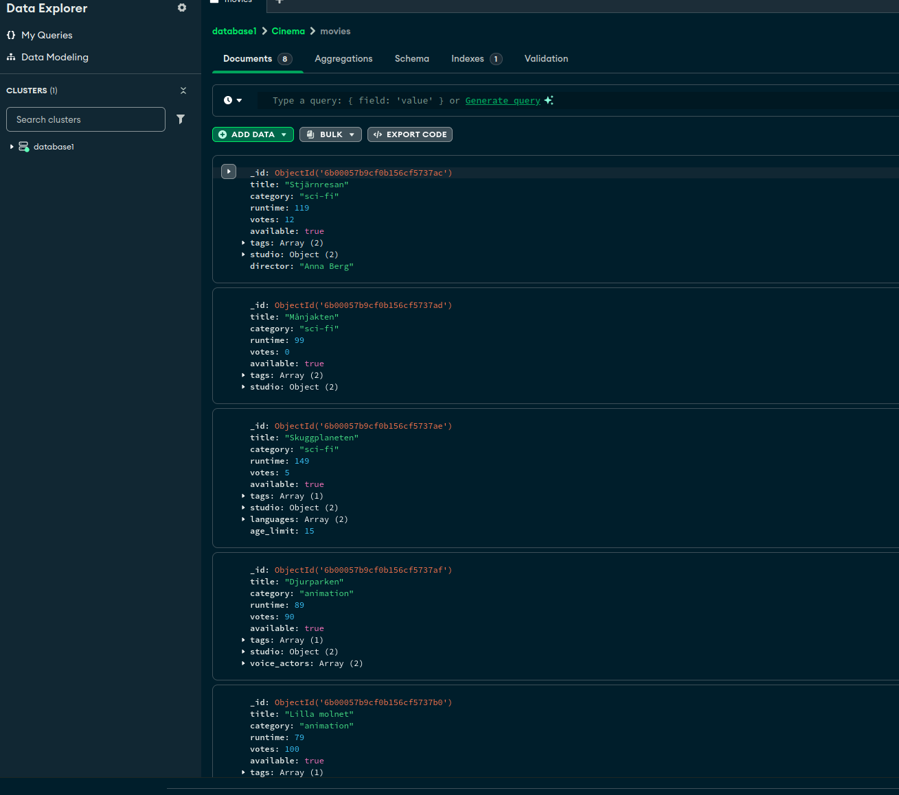
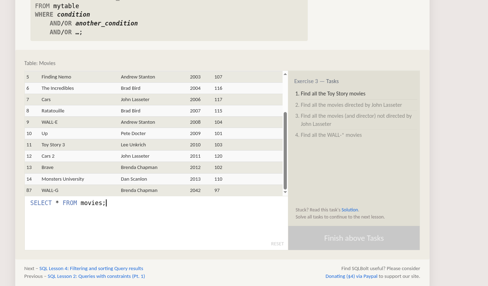

# 1. Vad är en databas, och vad kan den användas till?
Databas är en samling av data som är organiserad på ett sätt som gör att hantera data blir nästan univeriallt. Det blir
lättare att lagra, hämta och uppdatera data. Databaser används nästan överallt där man behöver lagra information, t.ex. banker, webbutiker osv.
Databaser lagrar information permanent så datan försvinner inte när man stänger av datorn. Datan lagras i tabeller likt en excel fil.

# 2. Vad används språket SQL till?
SQL språket är ett universellt språk som används för att hantera databaser. Det kan finnas vissa skillnader mellan olika
databaser men i stora drag är dom likadana. Exempel på syntax är SELECT, INSERT OCH UPDATE. SQL språk skrivs i "plain English".

# 3. Vad är en tabell, en rad och en kolumn?
Tabell är en samling av data som är organiserad i rader och kolumner. Rad representerar en enskild "objekt" och kolumn
representerer en egenskap av objektet. T.ex. objektId eller namn.

# 4. Vad är en primärnyckel, och varför behövs den?
PrimaryKey är en unik identifierare för varje objekt i tabellen. Den är viktig för att kunna enkelt hitta rätt objekt
i en tabell. Istället för att leta igenom alla namn kan databasen söka efter objektId 24 och då kan databasen direkt hitta rätt objekt. 

# 5. Vad är en främmande nyckel?
En främmande nyckel är en kolumn i en tabell som pekar på en primärnyckel i en annan tabell. Dvs det är ett sätt att joina flera tabeller.
# 6. Varför är det bra att lagra kunduppgifter och köp i olika tabeller?
För att man ska kunna lagra kund-infromation på ett strukturerat sätt. Address, namn, id osv är lätt att spara i kolumner.
Produkter har olika egenskper som storlek, färg, pris osv. Om man lagrar allt i en tabell blir det svårt att hantera informationen.
Och utöver det blir det svårt att skriva in allt eftersom en relationsdatabas måste allt se ut exakt likadant för att få SQL databasen att fungera. 
Objekt kan inte ha olika egenskaper i en SQL databas som i en NoSQL databas. Därför är det bättre att lagra kunduppgifter och köp i olika tabeller.

# 7. Vad menas med NoSQL, och hur kan information organiseras i en sådan databas?
NoSQL är mer flexibel än en vanlig SQL databas. Det är en databas som inte lagrar data i tabeller utan JSON osv. Fördelen
med noSQL är man kan lagra data som inte är lika strukturerad som t.ex. en chatt.

# 8. Ge ett exempel på när en NoSQL-databas kan vara lämplig och förklara varför.
Om man lagrar väldigt mycket data kan nosql vara fördelaktigt. T.ex. en chatt där man lagrar meddelanden, bilder, videos osv.
I en vanlig SQL databas ska allt kunna sättas in i en excel tabell som inte är möjligt i exempemlen nämnt ovan.

# 9. Hämta alla kolumner för alla personer i tabellen.

# 10. Hämta endast förnamn och efternamn för alla personer.

# 11. Hämta förnamn, efternamn och inkomst för personer med en inkomst över 30 000.

# 12. Hämta alla personer födda före den 1 januari 1990.

# 13. Hämta förnamn, efternamn och inkomst, sorterat efter inkomst från högst till lägst.

# 14. Räkna hur många personer som finns i tabellen.

# 1. En banköverföring avbryts efter att pengarna dragits från det första kontot.
# Vad kan konsekvensen bli, och hur kan en transaktion hjälpa?
Om en banköverföring avbryts utan transaktion kan det leda till att pengarna dras från första kontot men sätts inte in
i det andra kontot. Detta kan leda till att kunden förlorar pengar och pengar "försvinner" i banksystemet vilket absolut inte får hända.
Om detta skulle ske skulle förtroendet för banksystemet minska drastiskt och leda till en större ekonomisk kris då pengar inte
kan överföras på ett säkert sätt. Transaktion ser till att ändringen i databaserna sker samtidigt. Och om något går fel
gör databasen en rollback som återställer ändringen som gjordes. Även om systemet kraschar under transaktionen så kommer
databasen att återställa sig själv vilket utökar driftsäkerheten. Detta är en av de största fördelarna med @transaktioner.
Transaktion använder sig av konceptet ACID som innebär att databasen är Atomic, Consistent, Isolated och Durable. Dessa koncept
garanterar en säker databas och transaktion. 

# 2. Välj ett enkelt system, antingen en webbutik eller en chatt.
# Resonera om när en relationsdatabas respektive en NoSQL-databas
# kan vara lämplig. Motivera med hur informationen ska lagras och användas.
En webbutik kan behöva olika databaser och det beror på vad man vill lagra. Kunduppgifter bör lagras i en relationsdatabas
eftersom det är viktigt att kunna hämta och uppdatera informationen på ett robust sätt.
Produkter har olika egenskaper (en tröja har storlek/färg, en dator har RAM/processor). NoSQL lagrar varje produkt som ett flexibelt dokument,
vilket gör det enkelt att lägga till nya egenskaper utan att ändra databasschemat. Det är också snabbare att läsa in
hela produktinformation i ett steg utan JOIN-frågor, vilket är bra för prestanda i en webbutik.

# MySQL

Skärmdump som visar database explorer i IntelliJ med skapad person-tabell med data:

NOT: Ni ska även ha skapat en user som bara har access till databasen my_database, ingen bild krävs

# MongoDB

Skärmdump av databas på MongoDB Atlas med skapad movie-collection med data:

# SQL

Skärmdump som visar att ni klarat av första två sidorna på sqlbolt.com:s interaktiva tutorial

